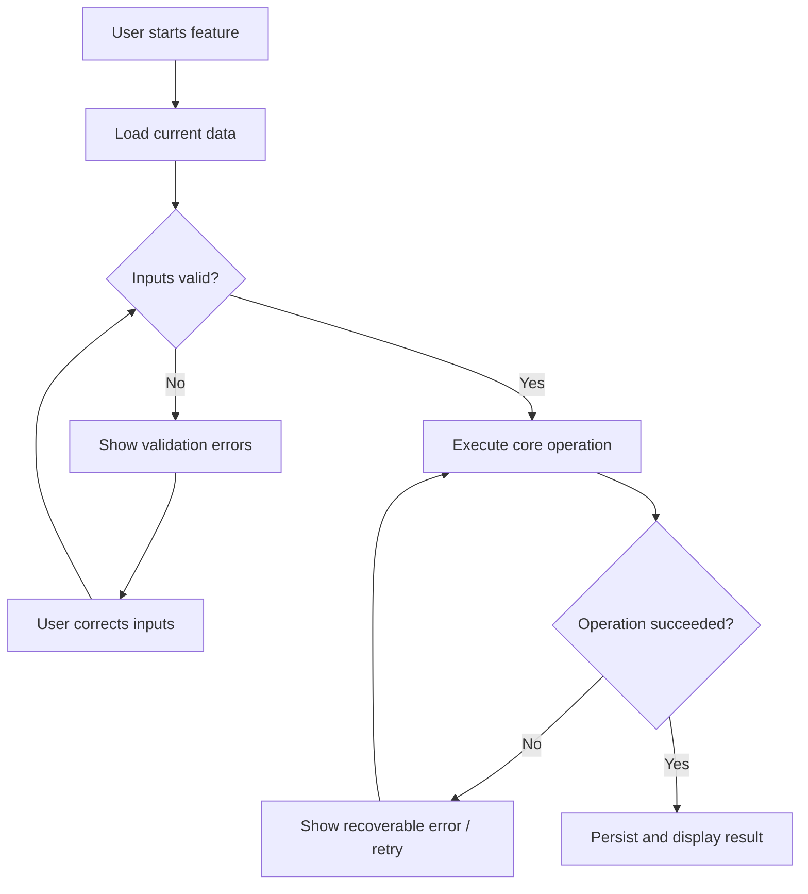
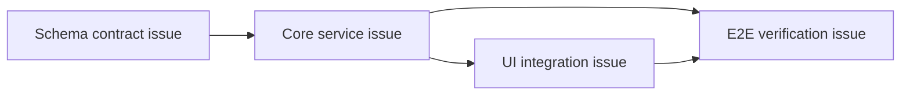

# Epic Issue authoring template

Use this template to create a **detailed real GitHub parent Issue** for every Epic before implementation. Adapt all sections to the actual product and repository; delete irrelevant examples rather than publishing empty boilerplate. Write in the user's/repository's working language.

## Required authoring rules

- The parent Epic is a **self-contained design specification and review entrypoint**: a developer can understand the desired behavior, architecture, constraints, scope, verification, and dependency ordering without chasing every child Issue.
- Include **at least one Mermaid `flowchart`** visualizing the Epic's **real feature behavior, decision points, data flow, system boundaries, or deployment/integration path**. A generic "plan → code → test" project-management diagram is **not acceptable** as the sole flowchart.
- Include both the **normal/success flow and material failure, validation or retry paths** where applicable. For an infrastructure Epic without end-user interaction, use a build, data-pipeline, lifecycle or component-flow chart instead.
- Add a **second Mermaid flowchart for sub-issue dependencies** when the Epic has non-trivial sequencing or cross-Epic blockers. Use **real Issue numbers/links** after the native sub-issues exist. Do not leave made-up IDs in the published diagram.
- Explain architectural boundaries, domain/data contracts, inputs/outputs, side effects, edge cases and relevant non-functional requirements. Do not invent chosen libraries, implementation details or guarantees without repository evidence or specification; label unresolved decisions explicitly.
- Make acceptance criteria independently observable, with named test cases/checks and a measurable success condition when applicable.
- Create the Epic first, then native child Issues with `--parent`, then update the Epic's child inventory and dependency chart with verified Issue links. Publish the finalized Epic **before coding**.
- **Validate GitHub-flavored Mermaid syntax** and whether nodes/edges match stated requirements. Prefer `flowchart TD` or `flowchart LR`, stable short node IDs, quoted visible labels, and readable edge labels. Check the rendered diagram in a GitHub preview when available; do not falsely claim it rendered if no preview exists.

## Suggested parent Issue title

`[E<n>] Epic: <clear feature or subsystem name>`

## Parent Issue body

### Problem / background

What problem is being solved, for whom, and why now? Link to related existing design or decisions.

### Goal and expected outcome

Describe the user/system-visible result, a concrete use case, and what success looks like.

### Scope

**In scope**

- Explicit capability or behavior 1
- Explicit capability or behavior 2

**Out of scope**

- Adjacent capability intentionally deferred

### Functional requirements and scenarios

1. **FR-01**: When `<condition>`, `<actor/system>` must `<behavior>` and `<observable result>`.
2. **FR-02**: On invalid input/failure, the system must `<error handling>`.
3. **FR-03**: Describe permissions, persistence, cancellation, undo, accessibility or other important paths as applicable.

### Proposed architecture and contracts

- **Owned components / modules:** boundaries, main entrypoints and responsibilities
- **Inputs / outputs:** types, formats, validation and error contracts
- **State / persistence:** authoritative data, concurrency, migrations or rollback if relevant
- **Integrations / dependencies:** upstream and downstream interfaces, ownership
- **Design decisions and alternatives:** decision, tradeoff, unresolved questions

### Mermaid: feature / system flow (required)

Replace the illustrative chart with a **feature-specific flow**, not a generic management workflow.

### Sub-issues and ownership

After creating native sub-issues, replace these placeholders with their **actual GitHub links** and verify parent-child relationships. Each child has its own bounded scope and acceptance criteria.

- [ ] `#<actual-id>` — Contract / schema / API (owner or interface notes)
- [ ] `#<actual-id>` — Core behavior / algorithm
- [ ] `#<actual-id>` — UI / integration
- [ ] `#<actual-id>` — E2E / cross-feature verification

### Dependencies and implementation order

Describe external blockers and parallel waves in plain language. If dependencies are non-trivial, include a second **real-ID Mermaid diagram**:

**Before publishing, replace every example node with a real Issue number/title (e.g. `#42 Schema`) and ensure arrows represent actual blocking dependencies.** For simple independent children, the inventory alone is sufficient.

### Non-functional requirements

- Performance: scale and observable target, or explicitly TBD
- Security/privacy: trust boundaries and sensitive data handling where relevant
- UX/accessibility/i18n: required behavior where relevant
- Reliability: failure recovery, cancellation, consistency, compatibility where relevant

### Acceptance criteria (Epic-level)

- [ ] The end-to-end primary path works with a representative example.
- [ ] Error and edge paths behave as specified and have named coverage.
- [ ] All native children are completed or explicitly deferred with owner approval.
- [ ] Integration tests / E2E / benchmark criteria are satisfied as applicable.
- [ ] The actual implementation matches the feature flow and documented contracts, or the Epic is updated to explain approved changes.

### Validation plan

List exact existing test commands or observable manual tests (do **not** invent test scripts), fixtures and expected results. State whether GitHub Actions is authorized or local-only under the project's policy.

### Risks, assumptions and open decisions

List critical risks, mitigation, dependencies and decisions that require human input. Avoid vague catch-all risks.

### PR stack / review lane

Identify the intended `stack/<topic>` review branch, constituent PR groups and their planned order, then update with real PR links as they are opened. `stack/<topic> → dev` requires explicit human approval.

---

## Final Epic quality gate

Before coding, inspect the published Issue and verify all of the following:

- [ ] Complete background, outcomes, scope and relevant architecture/contracts
- [ ] Functional requirements include success and important error/edge cases
- [ ] A **renderable, Epic-specific Mermaid flowchart** is present, meaningful and correctly labeled
- [ ] Any non-trivial Issue dependency DAG shows **real Issue IDs** and accurate arrows
- [ ] Native sub-issues exist, are attached to the parent, and cover every requirement
- [ ] Explicit acceptance criteria, validation plan, design decisions and review-lane ownership
- [ ] Mermaid/links/readability verified; no placeholders or made-up decisions remain

Do not open broad implementation PRs or mark the Epic planning complete if this quality gate is not satisfied.